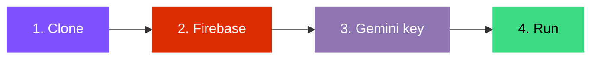
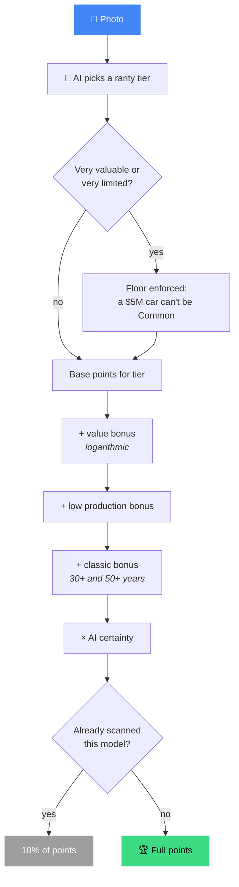

<a id="readme-top"></a>

<div align="center">


# 🚗 CarScanner

### Spot a car. Snap it. Collect it.

**An Android app that identifies cars from photos using AI, rates how rare they are,<br>and turns car spotting into a collection game.**

<br>

[](LICENSE)
[](https://developer.android.com)
[](https://kotlinlang.org)
[](https://developer.android.com/jetpack/compose)

[](https://aistudio.google.com)
[](https://firebase.google.com)
[](#-build-it-yourself)
[](#-build-it-yourself)

[](https://github.com/ItzjustElias/CarScanner/stargazers)
[](https://github.com/ItzjustElias/CarScanner/network/members)
[](https://github.com/ItzjustElias/CarScanner/issues)
[](#-contributing)
[](https://github.com/ItzjustElias/CarScanner/commits)

<br>

[**Features**](#-features) ·
[**Rarity Tiers**](#-rarity-tiers) ·
[**Build It**](#-build-it-yourself) ·
[**Scoring**](#-how-scoring-works) ·
[**Troubleshooting**](#-troubleshooting) ·
[**Contributing**](#-contributing)

</div>

---

## 📖 Table of Contents

<details>
<summary>Click to expand</summary>

- [About](#-about)
- [Features](#-features)
- [Rarity Tiers](#-rarity-tiers)
- [Tech Stack](#-tech-stack)
- [Build It Yourself](#-build-it-yourself)
- [Configuration](#-configuration)
- [How Scoring Works](#-how-scoring-works)
- [Project Structure](#-project-structure)
- [Important Notes](#-important-notes)
- [Troubleshooting](#-troubleshooting)
- [Roadmap](#-roadmap)
- [Contributing](#-contributing)
- [License](#-license)

</details>

---

## ✨ About

Take a photo of a car (or pick one from your gallery) and CarScanner tells you what it is, how rare it is,
and how much it's worth. Every scan earns points based on rarity and value, so you level up and fill
your **garage** with a collection of cards.

> [!TIP]
> **Designed to be forked.** Anyone can run their own copy on their own phone for **free**, using their own
> Firebase project and their own Gemini API key. **No server required.**

<p align="right">(<a href="#readme-top">back to top</a>)</p>

## 🎯 Features

| | Feature | Details |
|---|---|---|
| 📸 | **Two ways to scan** | Live camera with a viewfinder, or pick an image from your gallery |
| 🧠 | **AI identification** | Make, model, year, body style, estimated value, production numbers and a fun fact |
| 💎 | **7 rarity tiers** | From Common all the way to Divine, which has an animated rainbow |
| 🏆 | **Points and levels** | Score depends on rarity, value, how few were built, age and AI certainty |
| 🏠 | **Garage** | Your collection as rarity-colored cards, paged for speed, with search, filters and sorting |
| 📊 | **Profile page** | Level, total garage value, unique models, scans this week, favorite brand, per-rarity breakdown, best scoring and most valuable cars |
| 🛠️ | **Fix wrong scans** | Tap **"Not the right car?"**, type the real car and the AI fills in the details |
| 🔐 | **Google sign-in** | With delete and sign-out confirmations |
| 🌐 | **Web-search grounding** | Optional, lets the AI look up very new cars |
| 🔒 | **Local data** | Everything stays **on your phone**, separate per Google account |

> [!NOTE]
> Re-scanning a model you already own only earns **10%** of the normal points, so no farming the same parked Civic.

<p align="right">(<a href="#readme-top">back to top</a>)</p>

## 💎 Rarity Tiers

| Tier | Badge | Base points |
|---|---|---:|
| Common |  | 10 |
| Uncommon |  | 20 |
| Rare |  | 40 |
| Epic |  | 70 |
| Legendary |  | 120 |
| Mythical |  | 200 |
| Divine |  | 350 |

> [!NOTE]
> The badge colors above are approximations for this README. The exact in-app colors live in the theme code.

<p align="right">(<a href="#readme-top">back to top</a>)</p>

## 🧰 Tech Stack

<div align="center">


</div>

| Area | Library |
|---|---|
| UI | Jetpack Compose (Material 3) |
| Camera | CameraX |
| Storage | Room + Paging 3 |
| Auth | Firebase Auth + Credential Manager (Google sign-in) |
| Images | Coil |
| Networking | OkHttp |
| AI | Gemini API |

<p align="right">(<a href="#readme-top">back to top</a>)</p>

## 🚀 Build It Yourself

**About 15 minutes.** You need:

- [Android Studio](https://developer.android.com/studio) (latest stable)
- A Google account
- An Android phone, or an emulator with Google Play



### 1️⃣ Clone and open

```bash
git clone https://github.com/ItzjustElias/CarScanner.git
```

Open the folder in Android Studio and let Gradle sync. It will fail until step 2 is done, that's expected.

### 2️⃣ Create a free Firebase project (Google sign-in)

1. Go to the [Firebase console](https://console.firebase.google.com) and click **Add project**.
   The free Spark plan is enough, no credit card needed.
2. Add an **Android app** with package name `com.example.carscanner`
   (if you change the package name in `app/build.gradle.kts`, use that one instead).
3. Add your **debug SHA-1** to that app. In Android Studio open the Gradle panel, then
   `app > Tasks > android > signingReport`, and copy the `SHA1` of the `debug` variant.
   Or run `./gradlew signingReport` in a terminal.
4. In Firebase go to **Build > Authentication > Get started > Sign-in method** and enable **Google**.
5. Download **`google-services.json`** (Project settings > Your apps) and put it in the **`app/`** folder.

> [!WARNING]
> **Do not commit `google-services.json`.** It's already in `.gitignore`.

> [!IMPORTANT]
> Download `google-services.json` **after** enabling Google sign-in and adding the SHA-1, otherwise it won't
> contain the web client ID the app needs.

### 3️⃣ Get a free Gemini API key

1. Go to [Google AI Studio](https://aistudio.google.com/apikey) and create an API key (free tier, no card).
2. In the project root, create or open `local.properties` (Android Studio creates it) and add:

```properties
GEMINI_API_KEY=your_key_here
# Optional:
GEMINI_MODEL=gemini-2.5-flash
GEMINI_SEARCH=true
```

See `local.properties.example`. This file is git-ignored.

### 4️⃣ Run it

Connect your phone with USB debugging on (or start an emulator) and press **Run** ▶️.

To keep the app installed, use **Build > Build APK(s)** and install the APK on your phone.

<p align="right">(<a href="#readme-top">back to top</a>)</p>

## ⚙️ Configuration

| Setting (`local.properties`) | Default | What it does |
|---|---|---|
| `GEMINI_API_KEY` | none | Your Gemini API key **(required)** |
| `GEMINI_MODEL` | `gemini-2.5-flash` | Model used for scans. Change it if Google renames or retires it |
| `GEMINI_SEARCH` | `true` | Lets the AI search the web for very new cars. Set to `false` if you hit quota errors. The app also falls back automatically |

<p align="right">(<a href="#readme-top">back to top</a>)</p>

## 🧮 How Scoring Works



On top of the base points per tier:

- 💰 a **value bonus** (logarithmic, so a $1M car isn't 100x a $10k car)
- 🏭 a **bonus for low production runs**
- 🕰️ a **bonus for classics** (30+ and 50+ years old)
- 🎯 multiplied by **how certain the AI is**, and reduced to **10%** for models you've already scanned

The AI picks the tier, then the app enforces a floor for very valuable or very limited cars so a $5M car
can't be rated Common.

> [!TIP]
> Want to tweak the balance? All the numbers are in `domain/PointsCalculator.kt` and `domain/Models.kt`.

<p align="right">(<a href="#readme-top">back to top</a>)</p>

## 🗂️ Project Structure

```text
app/src/main/java/com/example/carscanner/
├── auth/         Google sign-in (Credential Manager + Firebase)
├── data/         Room database, Gemini API client, repository
├── domain/       rarity tiers, points and level rules
└── ui/
    ├── login/        sign-in screen
    ├── garage/       collection, search/filter, detail sheet, "fix this car"
    ├── scan/         camera, gallery picker, result screen
    ├── profile/      stats page
    ├── theme/        colors, typography, animated rarity styling
    └── components/   shared widgets
```

<p align="right">(<a href="#readme-top">back to top</a>)</p>

## ⚠️ Important Notes

> [!CAUTION]
> **Your API key is compiled into the app.** That's fine for your own phone. **Never publish an APK you built
> with your key**, and never commit `local.properties`. For a public app you would need a backend that holds the key.

> [!WARNING]
> **Photos are sent to Google's Gemini API** for identification. Free-tier requests may be used by Google
> to improve its products, so avoid photographing license plates or people.

> [!NOTE]
> **The AI can be wrong**, especially for rare, modified or very new cars. Values and production numbers are
> estimates, not market data. Use **"Not the right car?"** to fix a scan.

> [!NOTE]
> Free-tier API limits apply and change over time. Check [Google's rate limit docs](https://ai.google.dev/gemini-api/docs/rate-limits)
> and your usage in AI Studio.

<p align="right">(<a href="#readme-top">back to top</a>)</p>

## 🩺 Troubleshooting

<details>
<summary><b>Build error: <code>default_web_client_id</code> not found</b></summary>

<br>

`google-services.json` has no web client ID. Enable Google sign-in in Firebase, add your SHA-1, re-download
the file, then clean and rebuild.

**Fallback:** copy the Web client ID from Firebase into a string resource and reference it in `auth/AuthManager.kt`.

</details>

<details>
<summary><b>Google sign-in fails ("developer error")</b></summary>

<br>

The SHA-1 in Firebase doesn't match your build. Re-add it and re-download `google-services.json`.

</details>

<details>
<summary><b>"Missing Gemini API key"</b></summary>

<br>

Add `GEMINI_API_KEY` to `local.properties` and rebuild.

</details>

<details>
<summary><b>"Free daily limit reached"</b></summary>

<br>

You hit the free quota. Wait for it to reset, or set `GEMINI_SEARCH=false`.

</details>

<details>
<summary><b>"That Gemini model isn't available"</b></summary>

<br>

Change `GEMINI_MODEL` to a current model from [AI Studio](https://aistudio.google.com).

</details>

<p align="right">(<a href="#readme-top">back to top</a>)</p>

## 🗺️ Roadmap

- [x] Camera and gallery scanning
- [x] Rarity tiers, points and levels
- [x] Garage with search, filters and sorting
- [x] Profile and stats page
- [x] Fix wrong scans
- [ ] Achievements
- [ ] Export / backup
- [ ] Full car detail page
- [ ] Dark / light theme toggle
- [ ] More languages

See the [open issues](https://github.com/ItzjustElias/CarScanner/issues) for proposed features and known problems.

<p align="right">(<a href="#readme-top">back to top</a>)</p>

## 🤝 Contributing

Contributions make open source great, and they are **greatly appreciated**. Issues and pull requests are welcome.

1. Fork the project
2. Create your feature branch (`git checkout -b feature/amazing-feature`)
3. Commit your changes (`git commit -m 'Add amazing feature'`)
4. Push to the branch (`git push origin feature/amazing-feature`)
5. Open a pull request

> [!WARNING]
> Please don't commit secrets or `google-services.json`.

<a href="https://github.com/ItzjustElias/CarScanner/graphs/contributors">
  
</a>

<p align="right">(<a href="#readme-top">back to top</a>)</p>

## 📄 License

Distributed under the [MIT License](LICENSE). See `LICENSE` for more information.

This project is not affiliated with Google, Firebase or any car manufacturer. Brand names belong to their
respective owners.

---

<div align="center">

**If you like CarScanner, give it a ⭐ and go spot something rare!**

[](https://github.com/ItzjustElias/CarScanner/stargazers)

</div>